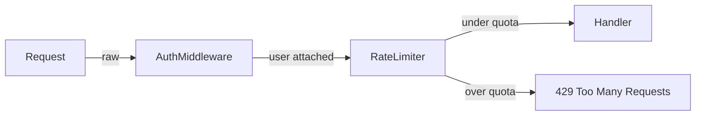

Load `skills/shared/interaction-patterns/SKILL.md` and use `AskUserQuestion` for every question with a finite set of answers — never a plain-text prompt. Load `skills/shared/output-format/SKILL.md` and apply it to all output. Read `.dev-team-agents/resolved/preferences.json` → `language` (default `en`) and write the explanation, the quiz, and every option label in that language.

**This command does not load `current-context` and does not spawn agents.** Both follow from the same fact: the terms come from the conversation you are already in. A subagent receives only the prompt text, so it would lose exactly what makes the explanation worth asking for — the message where the term appeared, the file it was about, the decision it belonged to. Answer in the main context.

**Concept first, project second.** Someone hit a word they did not know and wants to understand it, not only to get past it. Teach the idea as it exists in the field: what the term means, where it comes from, how it works and what it gets confused with. The session and the project only decide which meaning to teach and add a short note at the end. Thorough is the goal; padding is not — every line must teach something the previous one did not.

---

## Step 1 — Resolve the term list

`$ARGUMENTS` is a comma-separated list of terms: `/devteam:explain SPA` or `/devteam:explain SPA, SSR, tenant, middleware`.

- Split on commas, trim whitespace, keep the user's original casing when displaying the term.
- If `$ARGUMENTS` is empty, ask in free text which term to explain. Do not guess from the last message.
- Above six terms, explain the first six and name the ones left out so the user can ask again. Never truncate silently.

---

## Step 2 — Pick the meaning

For each term, decide which meaning to teach, top-down, and stop at the first match:

1. **It appeared in this session** — find where. The sense the session used is the one to teach first, but taught as a concept: "what is middleware", not "what is the middleware in this repo".
2. **Several meanings exist** — a `tenant` in multi-tenancy against a domain entity named Tenant: give the session's reading first, then the other, each as its own concept.
3. **No session context** — teach the general meaning.

Optionally `grep` the project for the term; a hit feeds only the **In this project** note below. Never invent a link to the project, and never explain a term in a sense nobody used.

---

## Step 3 — Write one block per term

### `<term>` — `<expansion>`

**Heading line:** expand every acronym or initialism, and give the translation of the words in the user's language when it differs: `FAB — Floating Action Button (botão de ação flutuante)`. A term borrowed from another language or field gets its literal meaning the same way. When it is neither, drop the dash.

Then these parts, in order. Skip a part only when it truly has nothing to say; never pad one.

| Part | What it carries |
|---|---|
| **Where it comes from** | One or two sentences: who coined it or which field it belongs to, and the era or the problem that produced it. Say "origin unclear" instead of guessing |
| **What it is** | Two to four sentences in plain language. Never define jargon with more jargon: a second term the user did not ask about gets a subordinate clause or a different word |
| **The problem it solves** | What people did before it existed and why that hurt. Never the definition restated |
| **How it works** | The mechanism, in three to six sentences or a short list: the parts, what triggers what, the rules that make it behave the way it does |
| **Example** | The shortest thing that shows the point (see below) |
| **Often confused with** | One to three neighbouring concepts and the line that separates them. This is where most misunderstandings are cleared up |
| **When to use it, when not to** | One line each, with the deciding factor |
| **In this project** | Only when a hit from Step 2 exists: one line with `file:line`. Drop the heading otherwise — an empty section reads as a failed lookup |

**Example.** A code concept: a fenced block in the language and framework detected from the repo (never defaulting to JavaScript), with every line the point does not need cut. Not a code concept: a concrete scenario with real names or numbers.

**Never write** an opening line about the question, a restatement of what was asked, a closing summary, an "in short" paragraph, or a caveat that the topic goes deeper. The quiz offer is the ending.

---

## Step 4 — Draw it, but only when the shape is the explanation

A diagram earns its place when the term **is** a shape and prose would spend sentences rebuilding it. Then draw one. Otherwise skip this step and lose nothing.

| Draw when the term is | Example terms | Mermaid type |
|---|---|---|
| A flow through stages | middleware, CI pipeline, request lifecycle | `flowchart LR` |
| Two paths worth comparing | SSR against CSR, sync against async, monolith against microservices | `flowchart TB`, one branch each |
| An exchange between parties | OAuth, JWT refresh, webhook, TLS handshake | `sequenceDiagram` |
| Containment or hierarchy | multi-tenancy, bounded context, VPC and subnets | `flowchart TB` with `subgraph` |
| A lifecycle with named states | saga, order status, connection pooling | `stateDiagram-v2` |

**Do not draw for a definition, a property, or a convention.** `idempotent`, `DTO`, `immutable`, `camelCase`, `tech debt`, `linter` — a box with the word inside it teaches nothing, and now there are two things to read instead of one. When in doubt, do not draw: a missing diagram costs a sentence, a pointless one costs attention and makes the answer feel long, which is the exact failure this command exists to avoid.

**Rules for the diagram:**

- A fenced code block tagged `mermaid`. It renders as a diagram where mermaid is supported and stays readable as text where it is not.
- **Three to seven nodes.** A diagram that has to be studied has failed. If the concept needs more than seven, you are drawing the system instead of the term.
- Label the edges with what actually moves — `request`, `token`, `retry after 3s` — never `next` or a bare line.
- Use generic names, or the project's real ones when Step 2 found a hit: `AuthMiddleware` beats `Middleware 1`.
- One diagram per term at most, placed after **How it works** so the shape frames the example. Never a second diagram to explain the first.

````markdown

````

---

## Step 5 — Offer the quiz (mandatory)

**Always close with this.** It is not conditional on how long the explanation was, how simple the term looked, or whether the user seemed satisfied.

Use `AskUserQuestion` (single-select):

> "Want to go deeper with an interactive quiz?"

- **Yes, cover everything** — a quiz across all the terms just explained
- **Yes, one term only** — ask which term, then quiz on that one
- **No, this is enough** — stop here

On the third option, print one line confirming it and end. Do not re-offer.

If `$ARGUMENTS` contains `--no-quiz`, skip Step 5 entirely and stop after the explanation blocks.

---

## Step 6 — Run the quiz (only when accepted)

**Shape.** Three to five questions per term, capped at eight questions total. Ask them **one at a time** with `AskUserQuestion` (single-select, three or four options). Never show the next question before the current one is answered, and never reveal how many are left in a way that lets the user skip ahead.

**Question quality.** Test application, not recall. A question that can be answered by re-reading the definition teaches nothing — put the term in a situation and ask what follows from it.

- Weak: "What does SSR stand for?"
- Strong: "A page shows an empty shell for a second, then fills in. Which rendering strategy is that, and what would the other one have shown instead?"

**Distractors.** Exactly one option is right. Each wrong option is a **real misconception** about the term, not filler — the confusion with a neighbouring concept, the inverted causality, the right idea applied at the wrong layer.

**After each answer**, in two or three lines:

- Say plainly whether it was right.
- Say why the correct answer is correct.
- When it was wrong, name the misconception the chosen option represents. That naming is the teaching moment — do not replace it with "not quite, the answer is B".

**At the end:**

- Score, as a plain count.
- One line per concept that was missed, stating what to revisit.
- When at least one answer was wrong, offer with `AskUserQuestion` to re-explain the weakest term with a different example, or to stop.

---

## Notes

- This command reads. It never edits files, never commits, and never runs the project's tools. If the explanation reveals an actual bug or a real gap in the code, say so in one line at the end and let the user decide which command to reach for — do not fix it here.
- If a requested term genuinely has no meaning in this project or in general software vocabulary, say that directly instead of producing a plausible definition. A confident wrong explanation is worse than "I do not know this one — where did you see it?".

Terms: $ARGUMENTS
